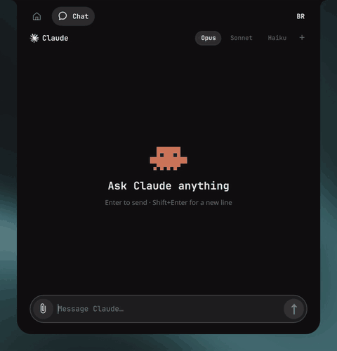
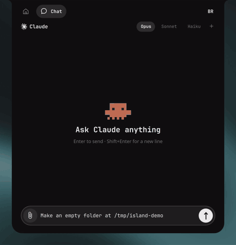
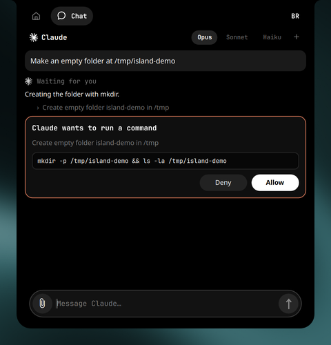

<div align="center">

# panacea-claude-bridge

**Claude in Panacea's island, on your subscription**




`Super+C` opens it, ready to type.


</div>

[Panacea](https://github.com/EnsixD/Panacea)'s island has a chat tab that
talks to any OpenAI-compatible endpoint. This repo puts **Claude Code** behind
that endpoint, so the island chat runs on your Claude Pro/Max subscription
through Claude Code's own login. There's no API key and no per-token billing.

It also reshapes the chat tab into a single Claude tab:

| Before | After |
|---|---|
| Island / Gemini / ChatGPT / DeepSeek tabs (web views) | One tab with the **Claude logo**, model pills **Opus · Sonnet · Haiku**, a new-chat button |
| Ctrl+Enter sends | **Enter** sends, Shift+Enter adds a new line, **Ctrl+N** starts a new chat |
| A generic ✦ and "Add an API address, model and key in the launcher settings" | A small orange pixel Claude that walks and blinks, and nothing to configure |
| "Думаю…" while it works | One **timeline** of live steps (searches, files read, commands, its remarks), with approval cards **in place of the step they're for** |
| Every action needs an answer | **Safe auto mode**: read-only commands (`ls`, `df`, `systemctl status`, `git log`, `pacman -Q`…) just run; anything that writes, deletes, installs or touches secrets still asks |
| A plain row of model names | Opus · Sonnet · Haiku with a selector that **slides** behind the names |
| Your messages and the reply blur together | Claude's replies carry its logo; each approval leaves a record in the conversation: **✓ Done**, **! Failed** or **× Denied**, with the exact command |
| Opening the chat leaves the message box unfocused | `Super+C` opens it with the cursor in the message box |
| Notifications that mention Claude/Codex pile up as cards in the chat | No notification cards in the chat (they stay in the notification centre) |
| Your draft and attachments are lost when you leave the chat page | Kept: they come back when you return (and the paperclip's island picker, from panacea-config, adds to them) |

## How it works

```
island chat ──POST /v1/chat/completions──▶ bridge.py (127.0.0.1:47321)
                                              │  claude -p --output-format stream-json
                                              │         --resume <session>  --model opus|sonnet|haiku
                                              ▼
                                       Claude Code ─▶ your subscription
```

- **Context:** the bridge keeps one Claude Code session per conversation and `--resume`s it, so it never resends the history. The new-chat button, or any history that doesn't match its last reply, starts a fresh session.
- **Images and files:** attached images are saved to `~/.cache/panacea-claude/attachments/` and given to Claude as paths.
- **Shared context:** Claude runs from your home folder, so it shares Claude Code's memory and `CLAUDE.md` with your other sessions there, and its sessions show up in Claude Code and the desktop app under that project.
- **What it may do:**
  - without asking: web search, reading web pages, reading files (except secrets: `~/.ssh`, `~/.gnupg`, keyrings, Proton data, the bridge token);
  - read-only commands, without asking (**safe auto mode**): a fixed list of programs that only look (`ls`, `cat`, `df`, `free`, `ps`, `ip`, `journalctl`, `systemctl status`, `git status/log/diff`, `pacman -Q`…), checked per subcommand, with no output redirection and no paths to secrets. Anything not on the list asks;
  - with your approval: everything else (running other commands, opening apps, editing files). Each request shows an approval card in the chat (and Panacea's notification card) with Allow / Deny; no answer means denied;
  - root work goes through `pkexec`, so system-file edits also ask for your password in the island.
- **While it works:** the chat shows one timeline of what Claude is doing (searches, files it reads, commands, its short remarks), in order, with the pixel Claude and its status at the bottom. An approval request takes the place of its step as a card: what it wants to do, why, the exact command or file, and Allow / Deny. Once answered it collapses in place into that step's record (*Allowed · running*, then **✓ Done**), without flicker, and Claude's next remarks continue below it. Panacea's island glows orange along its edge while Claude works. Panacea's notification card fires too for when you're elsewhere; answering either withdraws the other. (Claude Code doesn't expose its thinking in this mode, so that part isn't shown.)
- **Look:** the Claude logo in the header, and a small orange pixel Claude walking in place on the empty chat.
- **Leave and come back any time:** the bridge owns the request, not the chat page. Close the island mid-task, or answer an approval from the notification, and when you reopen the chat it's exactly where Claude is: still working, waiting on a card, or with the reply already in.
- **A sysadmin that knows the machine:** every message (new chat or not) carries a live profile of the computer from `sysprofile.py`: hardware, GPUs and driver, displays, disks, battery health, OS and versions, running services. It also carries your own notes from `~/.config/panacea-claude/notes.md` (layout, house rules; see `notes.example.md`). The profile rebuilds at startup, every 6 hours, after package changes and when you edit the notes. **New chat** clears the conversation and starts a fresh session; the bridge and the sysadmin prompt stay.
- **Long tasks:** the chat script's 90 s limit is raised to 10 minutes, to leave room for approvals.

### Approval cards



Anything that isn't read-only waits for you, with the pixel Claude waving for your attention: the card says what Claude wants to do,
why (in its own words), and the exact command or file. The in-chat card waits
up to 2 minutes; no answer means denied, and Claude explains what it wanted
instead of retrying.

### Safety

The bridge listens on `127.0.0.1` only and requires a random bearer token
(`~/.config/panacea-claude/token`, 0600), so a web page can't reach it through
localhost. Secrets (`~/.ssh`, `~/.gnupg`, keyrings, Proton data, the token
itself) are denied even for reading.

## Install

Needs Panacea, and Claude Code logged in with your subscription
(`curl -fsSL https://claude.ai/install.sh | bash`, then `claude` → `/login`).

```sh
git clone https://github.com/aphesist/panacea-claude-bridge && cd panacea-claude-bridge
bash install.sh
```

The installer:
- sets up the bridge as a user service (`panacea-claude.service`);
- writes `aiUrl`, `aiModel` and `aiKey` into Panacea's settings, keeping a backup;
- patches `ChatView.qml`;
- sends one test message.

The patch re-applies itself after Panacea updates (`panacea-chat-patch.path`).
If an update moves its anchors, it changes nothing, and the stock chat keeps
working with the bridge.

Logs: `journalctl --user -u panacea-claude -f`

Undo: `systemctl --user disable --now panacea-claude panacea-chat-patch.path`,
then restore `~/.config/panacea/ChatView.qml.pristine`.

## Credits

[Panacea Shell](https://github.com/EnsixD/Panacea) by EnsixD (MIT); the patch
quotes small parts of its QML in order to find its place. Uses
[Claude Code](https://claude.com/claude-code) as an external program and is not
affiliated with Anthropic.

Claude and the Claude logo are trademarks of Anthropic. The logo file (`assets/claude-logo.svg`) comes from [Simple Icons](https://simpleicons.org) (CC0); it's used here only to label the Claude chat.
